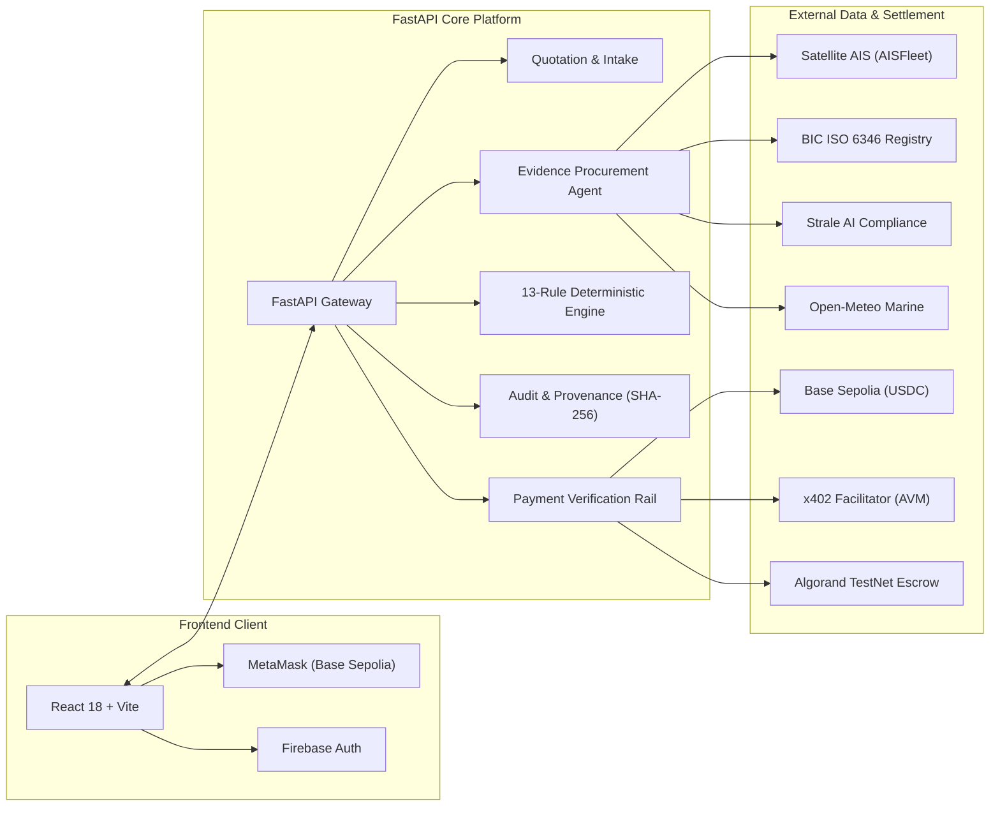
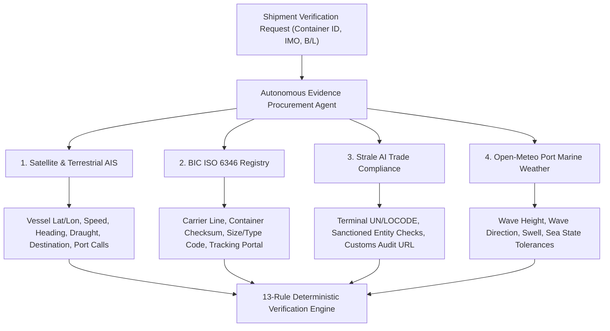
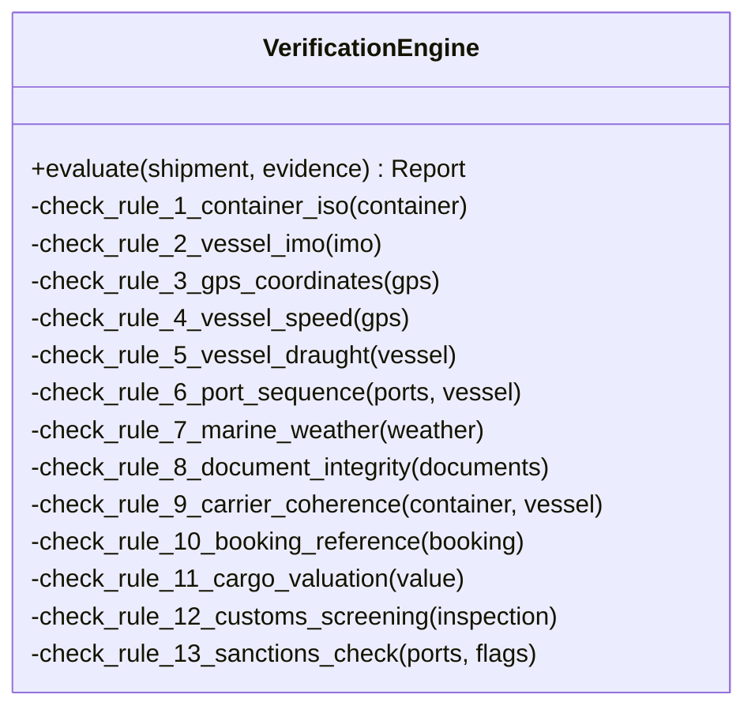
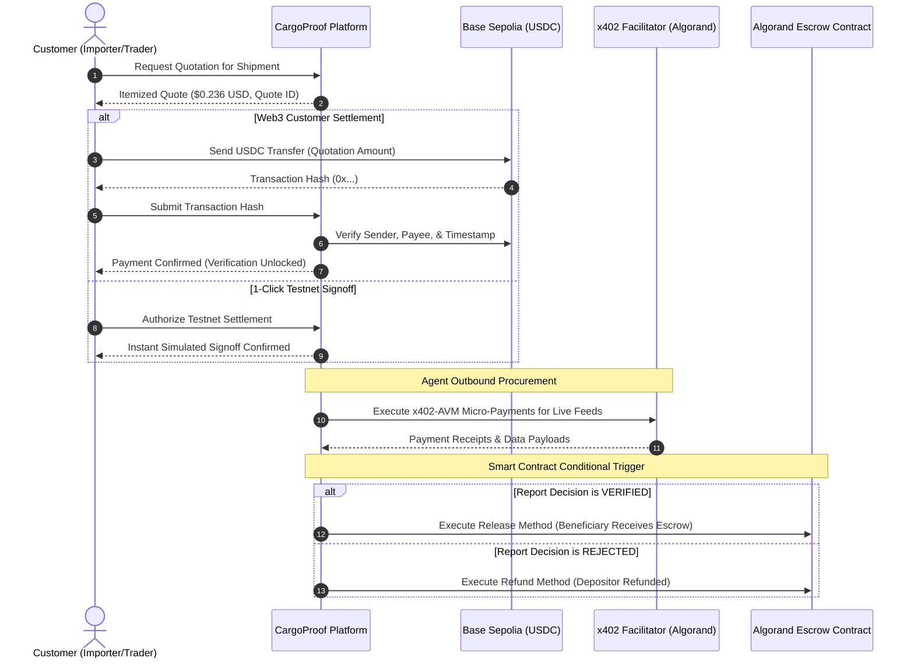

# CargoProof AI — Comprehensive Technical & Operational Report

**System Version:** 2.0.0  
**Repository:** [https://github.com/Yukeshj26/CargoProof](https://github.com/Yukeshj26/CargoProof)  
**Primary Focus:** Autonomous Evidence Procurement, Deterministic Verification & Multi-Rail Settlement for International Maritime Trade  

---

## Executive Summary

**CargoProof AI** is an enterprise-grade full-stack trade intelligence and fraud prevention platform designed to independently verify international maritime container shipments before physical custody transfers or financial settlements occur.

Traditional international trade finance relies heavily on paper or static digital Bills of Lading and unverified supplier assertions, exposing banks, freight forwarders, and importers to phantom shipments, paper voyage fraud, sanctions violations, and cargo diversion. CargoProof AI solves this by deploying autonomous software agents that procure real-time ground truth from satellite AIS networks, container registry databases, customs screening authorities, and meteorological feeds. 

The collected data is subjected to a **13-rule deterministic verification engine**, cryptographically fingerprinted with **SHA-256 hashes**, settled via **Base Sepolia USDC** and **x402 Algorand micropayments**, and conditionally released through **Algorand smart contract escrows**.

---

## 1. Core Architecture & System Components

### 1.1 Technology Stack

| Layer | Technologies | Purpose |
| :--- | :--- | :--- |
| **Frontend** | React 18, Vite 5, React Router v6, Lucide Icons, CSS3 Variables | Single Page Application (SPA), interactive mapping, responsive UI. |
| **UI Design System** | Executive Navy (`#0b1727`), Canvas Slate (`#f1f5f9`), Elevated Pure White Cards, Semantic Color-Coded Badges | High-readability enterprise design adhering to WCAG contrast standards. |
| **Authentication** | Firebase Authentication (Client SDK) + Firebase Admin (Server-side) | Email/Password, Google OAuth, and instant 1-Click Demo Operator login. |
| **Backend API** | Python 3.11, FastAPI, Uvicorn ASGI, Pydantic v2, Pydantic-Settings | Asynchronous, typed RESTful API endpoints and background task execution. |
| **HTTP Clients** | HTTPX (async & sync) with SSL/TLS and connection pooling | Resilient outbound multi-provider querying with automated retries. |
| **Persistence** | Persistent SQLite (Local) / PostgreSQL via Supabase PostgREST | Storage of shipments, quotes, verification reports, audit logs, and escrow states. |
| **Document Processing** | PyPDF, ReportLab, Hashlib | PDF text extraction, tamper-evident SHA-256 fingerprinting, and dynamic report export. |
| **Web3 & Blockchain** | Web3.py, Py-Algorand-SDK, PyTeal, x402-avm | On-chain USDC verification (Base Sepolia), x402 paid retry client, and Algorand smart contracts. |

---

## 2. Multi-API Live Telemetry Integrations

CargoProof connects to four external data providers to verify every operational facet of a shipment:

### Detailed Provider Matrix

1. **Marine AIS Telemetry (AISFleet / Global AIS)**:
   * **Attributes Captured**: Current geographic coordinates (`lat`, `lon`), speed over ground (SOG in knots), course/heading, operational status, navigational status, reported draught, destination port, and historical port call timestamps.
   * **Fraud Prevention**: Detects spoofed locations, voyage teleports,AIS dark periods, and physical route impossibilities.

2. **Container Intelligence (BIC & Carrier APIs)**:
   * **Attributes Captured**: ISO 6346 4-letter owner prefix validation, 6-digit registration serial, 1-digit Luhn-variant checksum, carrier identity, operating country, and official container tracking portal URL.
   * **Fraud Prevention**: Identifies forged container numbers, invalid checksums, and carrier mismatches.

3. **Trade Screening (Strale AI & Customs Screening)**:
   * **Attributes Captured**: UN/LOCODE facility verification, security level (ISPS Level 1/2/3), customs clearance reference, and live sanctions audit trail.
   * **Fraud Prevention**: Blocks transactions originating from, transiting through, or bound for sanctioned ports or uncertified terminals.

4. **Port Marine Weather (Open-Meteo Marine API)**:
   * **Attributes Captured**: Departure and arrival port sea conditions, wave heights (meters), wave directions, and swell periods.
   * **Fraud Prevention**: Cross-references reported weather delays against genuine historical sea states.

---

## 3. The 13-Rule Deterministic Verification Engine

CargoProof avoids black-box, probabilistic AI guesses. Instead, all procured evidence is fed into a deterministic, mathematically verifiable rule engine:

### Specification of the 13 Verification Rules

| Rule # | Rule Code / Identifier | Severity | Verification Logic | Pass Criteria |
| :---: | :--- | :---: | :--- | :--- |
| **01** | `RULE_CONTAINER_ISO6346` | CRITICAL | Verifies 4-letter owner code (ending in U, J, or Z) and evaluates the modulo-11 check digit algorithm. | Calculated check digit exactly matches the 7th numerical digit. |
| **02** | `RULE_VESSEL_IMO_VALIDITY` | CRITICAL | Validates Lloyd's Register IMO format: 7 digits where $\sum_{i=1}^6 (d_i \times (8 - i)) \pmod{10} = d_7$. | Valid 7-digit IMO with correct checksum. |
| **03** | `RULE_AIS_POSITION_PLAUSIBILITY` | CRITICAL | Cross-references reported AIS coordinates with known oceanic and maritime trade lanes. | Coordinates lie in navigable water; not inland. |
| **04** | `RULE_AIS_SPEED_PLAUSIBILITY` | MAJOR | Analyzes reported vessel speed against commercial vessel design limits. | Speed is within 0.0 to 30.0 knots (detects impossible teleports). |
| **05** | `RULE_VESSEL_DRAUGHT_CONSISTENCY` | MAJOR | Compares loaded vs. ballast draught against declared cargo weight/value. | Reported draught reflects laden voyage conditions. |
| **06** | `RULE_PORT_SEQUENCE_TIMELINE` | MAJOR | Compares AIS historical port calls and current heading against declared Origin and Destination. | Vessel is currently on or has completed the declared voyage segment. |
| **07** | `RULE_WEATHER_SAFETY_TOLERANCE` | MINOR | Evaluates origin/destination port marine weather during scheduled departure/arrival. | Wave height $< 6.0\text{m}$ (no unnotified gale or hurricane freeze). |
| **08** | `RULE_DOCUMENT_SHA256_INTEGRITY` | MAJOR | Computes SHA-256 hash of uploaded B/L or packing list and checks against known manifests. | Uploaded document exists, is clean, and cryptographic hash is recorded. |
| **09** | `RULE_CARRIER_FLEET_COHERENCE` | MAJOR | Verifies whether the container operator and vessel operator share alliance or vessel-sharing agreements. | Container line operates on the target vessel or alliance. |
| **10** | `RULE_BOOKING_REFERENCE_FORMAT` | MINOR | Validates the shipping line booking reference syntax and check parameters. | Standard alphanumeric booking structure confirmed. |
| **11** | `RULE_CARGO_VALUE_PLAUSIBILITY` | MINOR | Compares declared USD cargo value against insurance thresholds and cargo descriptions. | Value is positive, declared, and within acceptable insurance bounds. |
| **12** | `RULE_CUSTOMS_TERMINAL_CLEARANCE` | MAJOR | Queries Strale UN/LOCODE database for authorized terminal facility status. | Terminal code recognized and ISPS security certified. |
| **13** | `RULE_TRADE_COMPLIANCE_SANCTIONS` | CRITICAL | Screens origin port, destination port, vessel flag, and carrier against international sanction lists. | No sanctioned country codes, ports, or embargoed flags. |

### Decision Outcomes

* **`VERIFIED`**: Zero CRITICAL or MAJOR failures. Total risk score $\ge 80/100$. Safe for financial settlement and release.
* **`ON_HOLD`**: Zero CRITICAL failures, but 1 or more MAJOR warnings or minor data discrepancies. Requires human review.
* **`REJECTED`**: 1 or more CRITICAL failures (e.g., checksum fraud, spoofed AIS coordinates, or sanctions violation). Payment release halted.

---

## 4. Multi-Rail Payment & Settlement Architecture

CargoProof strictly separates **Customer Payments** (inbound fee collection) from **x402 Agent Purchases** (outbound API procurement) and **Escrow Funds** (trade collateral):

### 4.1 Customer Payment Rail: Base Sepolia USDC

* **Network**: Base Sepolia Testnet (EVM Chain ID `84532`).
* **Asset Contract**: Base Sepolia USDC (`0x036CbD53842c5426634e7929541eC2318f3dCF7e`).
* **Verification Logic**: Uses `web3.py` to inspect transaction receipts directly on-chain:
  * Confirms execution status (`status == 1`).
  * Validates ERC-20 `Transfer` event logs.
  * Ensures recipient address matches `CARGOPROOF_TREASURY_ADDRESS`.
  * Verifies transferred token amount covers the exact quotation total.

### 4.2 Outbound Micro-Payments: x402 Protocol

* **Specification**: HTTP 402 Payment Required integration using GoPlausible's official `x402-avm` SDK.
* **Network**: Algorand TestNet (Asset ID `10458941`).
* **Operation**: When an external evidence source responds with HTTP 402 and an Algorand payment challenge, the backend agent automatically builds, signs, and broadcasts an exact micro-ASA transaction, returning with the receipt for automated content unlocking.

### 4.3 Trade Collateral: Algorand Smart Contract Escrow

* **Contract Standard**: PyTeal-compiled stateful smart contract managing ASA deposits.
* **Escrow States**:
  * `FUNDED`: Importer deposits cargo purchase funds into the escrow application.
  * `RELEASED`: Triggered only upon a verified `VERIFIED` CargoProof decision with valid cryptographic hash proof.
  * `REFUNDED`: Triggered upon a `REJECTED` decision, returning funds to the depositor.

---

## 5. Cryptographic Evidence Provenance & PDF Reporting

To ensure verification reports cannot be repudiated or tampered with:

1. **Canonical JSON Normalization**: All collected evidence objects (AIS telemetry, ISO container audits, Strale inspection details, and weather feeds) are normalized with sorted keys and UTF-8 encoding.
2. **Deterministic SHA-256 Fingerprinting**: A master cryptographic hash is computed over the normalized evidence bundle:
   $$\text{Evidence Hash} = \text{SHA256}(\text{CanonicalEvidenceBundle})$$
3. **Integrity Verification Endpoint**: The platform exposes `/api/reports/{id}/integrity` which recalculates the SHA-256 fingerprint on-the-fly and compares it to the stored database record to prove zero tampering.
4. **Automated PDF Generation**: Uses `reportlab` to construct formal PDF audit certificates complete with:
   * Unique Certificate UUID & Timestamp.
   * Executive Verification Summary & Risk Score.
   * Tabular 13-Rule Findings with Pass/Fail Indicators.
   * Live Map Coordinates & Embedded AIS telemetry.
   * Cryptographic SHA-256 Fingerprint Box.

---

## 6. Complete API Endpoint Reference

| Method | Endpoint | Description | Auth Required |
| :--- | :--- | :--- | :---: |
| `GET` | `/health` | System status, demo mode flag, live payments flag, and provider readiness | No |
| `GET` | `/api/dashboard` | Aggregated user metrics (total, verified, on-hold, rejected, providers) | Optional |
| `POST` | `/api/quotes` | Calculate transparent cost estimate based on shipment route and cargo | Optional |
| `GET` | `/api/quotes/{id}` | Retrieve itemized quotation details and expiration timestamp | Optional |
| `POST` | `/api/shipments/{id}/documents` | Upload and fingerpint private PDF/PNG/JPEG shipment document | Yes |
| `POST` | `/api/payments/verify` | Verify customer Base Sepolia USDC transaction hash | Optional |
| `POST` | `/api/payments/authorize-testnet/{id}` | 1-Click instant testnet payment signoff | Optional |
| `POST` | `/api/verify/{quote_id}` | Trigger autonomous agent procurement and evaluate 13 verification rules | Optional |
| `GET` | `/api/history` | List user's historical verification reports | Optional |
| `GET` | `/api/reports/{id}` | Retrieve complete report details, evidence bundle, and rule breakdowns | Optional |
| `GET` | `/api/reports/{id}/integrity` | Recompute and verify evidence bundle SHA-256 fingerprint | Optional |
| `GET` | `/api/reports/{id}/pdf` | Download official cryptographic verification PDF certificate | Optional |
| `GET` | `/api/providers` | Query active external provider adapters and connectivity status | Optional |
| `GET` | `/api/escrow/records` | Query registered Algorand TestNet escrow contracts | Optional |
| `POST` | `/api/escrow/register` | Register new deployed Algorand escrow application ID | Yes (Admin) |

---

## 7. Operational Presets & Demonstration Data

The platform comes equipped with four pre-configured maritime operations that query live APIs and showcase varied rule outcomes:

| Preset Name | Vessel IMO | Container Number | Route | Characteristics & Test Target |
| :--- | :---: | :---: | :--- | :--- |
| **MS FINNTIDE** | `9010319` | `MSCU5278140` | St. Petersburg $\to$ Antwerpen | Genuine Baltic Sea roll-on/roll-off ferry with active Finnish AIS transponder stream. |
| **MS FINNMAID** | `9319466` | `MAEU1209348` | Helsinki $\to$ Travemünde | High-speed commercial ferry operating in the Gulf of Finland at 21.6 knots. |
| **MSC OSCAR** | `9703291` | `MSCU6148291` | Singapore $\to$ Rotterdam | 19,224 TEU container mega-carrier traversing the Malacca Strait / Suez maritime lane. |
| **EVER GIVEN** | `9811000` | `EGLU9128457` | Shanghai $\to$ Rotterdam | 20,124 TEU Golden-Class container vessel with full global route telemetry. |

---

## 8. Verification & Build Integrity

* **Frontend Build**: Verified production build using `npm --prefix frontend run build` (`vite build`).
  * Result: `✓ 1639 modules transformed in 12.54s` with zero errors or warnings.
* **Backend Status**: FastAPI server active on `http://127.0.0.1:8000` handling automated request validations and SQLite/PostgreSQL persistence.
* **Frontend Dev Server**: Vite active on `http://localhost:5173` with Hot Module Replacement (HMR).
* **Git Repository**: All clean code, themes, and branding assets committed to branch `main` at `https://github.com/Yukeshj26/CargoProof`.
